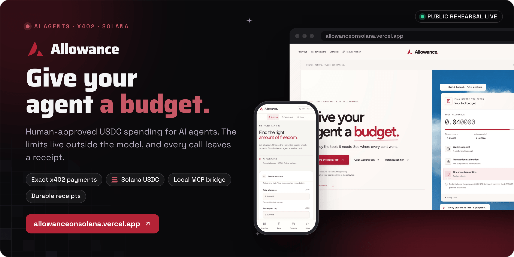
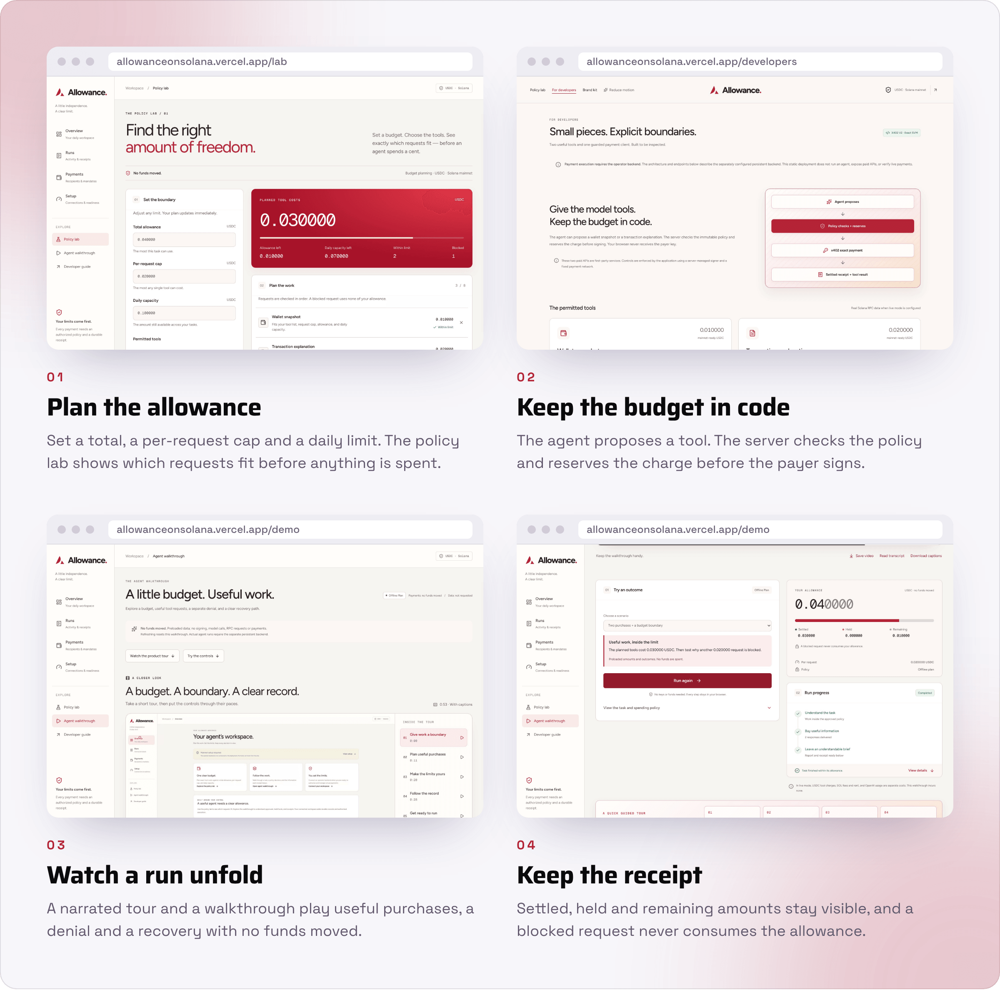

<div align="center">



<br><br>

<a href="https://allowanceonsolana.vercel.app/lab"></a>&nbsp;&nbsp;
<a href="https://allowanceonsolana.vercel.app/demo#product-tour"></a>&nbsp;&nbsp;
<a href="https://allowanceonsolana.vercel.app/developers"></a>

<br><br>

<a href="https://github.com/operatoruplift/allowance/actions/workflows/ci.yml"></a>
<a href="https://allowanceonsolana.vercel.app"></a>


<a href="LICENSE"></a>

<h3>Let it buy the tools it needs. See where every cent went.</h3>

<b>Approve</b> &nbsp;→&nbsp; <b>Propose</b> &nbsp;→&nbsp; <b>Check</b> &nbsp;→&nbsp; <b>Reserve</b> &nbsp;→&nbsp; <b>Sign</b> &nbsp;→&nbsp; <b>Receipt</b>

<br>

<a href="#how-it-works">How it works</a> &nbsp;·&nbsp;
<a href="#the-trust-model">Trust model</a> &nbsp;·&nbsp;
<a href="#status">Status</a> &nbsp;·&nbsp;
<a href="#run-it-locally">Run it locally</a> &nbsp;·&nbsp;
<a href="#documentation">Docs</a>

</div>

<br>

<picture>
  <source media="(prefers-color-scheme: dark)" srcset="docs/readme/screens-dark.png">
  
</picture>

<p align="center"><sub>Captured from a local build of the public rehearsal on 30 October 2026. No funds moved.</sub></p>

**Allowance gives an AI agent a fixed, human-approved USDC budget for exact x402 payments on Solana.** A person sets the budget, the per-request cap, the permitted tools or recipients, and the expiry. The agent only proposes: the server checks each request against that frozen policy, reserves the charge in a durable ledger, and only then lets a dedicated payer sign. Every decision, hold and settlement lands in a receipt.

Built by Matt ([RVAClassic](https://x.com/rvaclassic), [Operator Uplift](https://operatoruplift.com)) for the Solana Foundation **Agentic Payments** sprint, September 2026.

<br>

## How it works

<picture>
  <source media="(prefers-color-scheme: dark)" srcset="docs/readme/flow-dark.png">
  
</picture>

<table>
  <tr valign="top">
    <td width="33%"><b>The limits live outside the model</b><br><sub>The model can only propose a purchase. Budget, per-call maximum, tools, recipient, network, mint and expiry form an immutable policy that application code enforces before anything is signed.</sub></td>
    <td width="33%"><b>Reserve, then sign</b><br><sub>A SQLite <code>BEGIN IMMEDIATE</code> transaction reserves the charge first. A unique purchase identity and a canonical request hash stop repeated signing, and a database failure denies new payments.</sub></td>
    <td width="33%"><b>Evidence, not claims</b><br><sub>A facilitator response, chain verification and a delivered result are recorded as separate evidence. A receipt only says <code>SETTLED</code> once the chain shows it.</sub></td>
  </tr>
</table>

Two payment rails share one policy engine, one daily ceiling and one receipt format:

<table>
  <tr>
    <th width="22%" align="left">Rail</th>
    <th width="39%" align="left">What the agent can do</th>
    <th width="39%" align="left">How it is gated</th>
  </tr>
  <tr valign="top">
    <td><b>x402 tool purchases</b></td>
    <td>Buy two first-party Solana data tools with exact x402 payments: <code>wallet_snapshot</code> for 0.010000 USDC and <code>transaction_explain</code> for 0.020000 USDC.</td>
    <td>The run's policy names the tools, the per-request cap and the budget. The guarded buyer checks the actual payment requirement before the payer signs.</td>
  </tr>
  <tr valign="top">
    <td><b>Direct payments</b></td>
    <td>Pay exact USDC to recipients the operator listed in advance, through the <code>execute_guarded_payment</code> MCP tool: one <code>TransferChecked</code> per request.</td>
    <td>A mandate fixes the per-request cap, ceiling, expiry and recipients. Blocked requests become durable <code>BLOCKED</code> receipts with nothing signed. See <a href="docs/direct-payments.md">direct payments</a>.</td>
  </tr>
</table>

<p align="center"><sub>React 19 · Vite 8 · Express 5 · TypeScript · SQLite (better-sqlite3) · @solana/kit 5 · x402 2.25 exact SVM · OpenAI Responses API · MCP stdio · Argon2id sessions · Vitest · Playwright · Docker</sub></p>

<br>

## The trust model

Allowance is a **server-managed signer with application-enforced controls**, and the scope is deliberate: controls live in application code, not in a custom onchain budget program, a smart wallet or a payment channel.

<table>
  <tr>
    <th width="24%" align="left">Control</th>
    <th width="76%" align="left">What it guarantees</th>
  </tr>
  <tr valign="top">
    <td><b>Exact money</b></td>
    <td>USDC is bounded integer micro-units inside, decimal strings at the API boundary. <code>0.04</code> is exactly <code>40000</code>.</td>
  </tr>
  <tr valign="top">
    <td><b>Frozen policy</b></td>
    <td>Budget, per-call maximum, tools, destination, recipient, network and mint, expiry and call limit are bound at approval. A shared UTC daily ceiling applies across runs, and outstanding holds still count when the day changes.</td>
  </tr>
  <tr valign="top">
    <td><b>Guarded signer</b></td>
    <td>The signer checks the actual transaction and records a signing claim before it touches the key. An uncertain outcome stays held and freezes the payer instead of retrying.</td>
  </tr>
  <tr valign="top">
    <td><b>Stop and expiry</b></td>
    <td>Both block new signatures. Work already signed can still settle, and a restart restores receipts and reconciliation without restarting the old model authorization.</td>
  </tr>
</table>

What it does not claim: a compromised server could defeat application-level controls. That is why the signer stays backend-only and the documented setup uses a dedicated low-balance payer, and why both shipped merchants are labeled as first-party sample services rather than third-party adoption. The full analysis is in the [threat model](docs/threat-model.md).

<br>

## Status

<table>
  <tr valign="top">
    <td width="16%" align="center"></td>
    <td>The public rehearsal at <a href="https://allowanceonsolana.vercel.app">allowanceonsolana.vercel.app</a>: landing page, policy lab, narrated tour and walkthrough, developer guide, brand library and installable PWA. It runs no backend, signer, model or payment endpoint.</td>
    <td width="22%"><a href="docs/vercel.md">Vercel deployment</a></td>
  </tr>
  <tr valign="top">
    <td align="center"></td>
    <td>Live x402 purchases and direct USDC payments on devnet or mainnet. Implemented and covered by controlled-adapter suites, closed until an operator supplies a persistent host, credentials and funded accounts. As of the 20 September 2026 inspection, no Allowance settlement had been observed on either network.</td>
    <td><a href="docs/integration-status.md">Integration status</a></td>
  </tr>
  <tr valign="top">
    <td align="center"></td>
    <td>The Seeker Android shell and Solana dApp Store listing. The WebView shell builds; native exports and device behavior still need validation, and the listing waits for a live server.</td>
    <td><a href="docs/seeker-and-pwa.md">Seeker and PWA</a></td>
  </tr>
  <tr valign="top">
    <td align="center"></td>
    <td>Payment channels and remote MCP, kept as design notes. The local stdio MCP bridge is implemented and shares the same policy, ledger and receipts.</td>
    <td><a href="docs/payment-channels.md">Payment channels</a></td>
  </tr>
</table>

<br>

## Run it locally

<table>
  <tr valign="top">
    <td width="33%"><b>Prerequisites</b><br><sub>Node 22.19 or newer in the 22 or 24 line, npm and a writable local disk. Docker for the container check.</sub></td>
    <td width="33%"><b>Read first</b><br><sub><a href="docs/live-setup.md">Live setup</a> and the <a href="docs/threat-model.md">threat model</a>, before any payment is switched on.</sub></td>
    <td width="33%"><b>What the checks prove</b><br><sub>The <a href="docs/verification.md">verification report</a> says what each check covers and what none of them do.</sub></td>
  </tr>
</table>

### 1. Run the app

```bash
npm ci
npm run dev        # http://127.0.0.1:4318, Express hosts Vite in one process
```

For a local production build, `npm run build` then `npm start`: Express serves `dist/client` and runs the bounded background worker.

### 2. Before a pull request, run what [CI](.github/workflows/ci.yml) runs

```bash
npm run check                      # lint, types, unit and integration tests, production build
npx playwright install chromium
npm run test:browser
npm run build:rehearsal && npm run test:hosted
```

Tests use deterministic adapters and isolated SQLite databases. They never spend or call paid APIs.

### 3. Open the operator workspace

```bash
cp .env.example .env
npm run setup:operator             # Argon2id hash and session secret into .env, mode 0600
npm run build && npm run preflight # configuration and network checks, no signing, no model calls
```

There is no public registration. Every live API stays closed until the password hash and session secret are in place, so a deployment without operator credentials cannot spend.

### 4. Live payments, only on purpose

| Setting | Effect |
|---|---|
| `LIVE_PAYMENTS_ENABLED=true` | Turns on real spending. Off by default. |
| `MAINNET_PAYMENTS_ACKNOWLEDGED=true` | Required as well for mainnet, the default network. |
| `PAYMENT_NETWORK=devnet` | Selects devnet for testing. Existing receipts keep their original network. |
| `DIRECT_PAYMENTS_ENABLED=true` | Opens the mandate rail for allowlisted recipients. |
| `MCP_ENABLED=true` and `MCP_GRANT_TOKEN` | Lets an authorized local agent use the stdio bridge (`npm run mcp`). |
| `OPENAI_API_KEY` and `OPENAI_MODEL` | Powers the built-in runner. The model ID is required and never guessed. |

```bash
# Only after configuring and explicitly authorizing a real-USDC spend:
npm run smoke:mainnet -- --confirm-mainnet-spend

# Testing alternatives, with PAYMENT_NETWORK=devnet:
npm run smoke:devnet -- --confirm-devnet-spend
npm run smoke:direct-devnet -- --confirm-devnet-spend
```

The scripted scenario spends at most 0.030000 USDC, and its separate 0.020000 probe must be denied before signing. Without the confirmation flag a smoke command exits before it creates a signer. Do not retry an uncertain payment under a new ID. Setup for payer and recipient accounts, the facilitator and the fee sponsor is in [live setup](docs/live-setup.md); every variable is in the [configuration reference](docs/configuration.md).

<details>
<summary><b>Docker and persistent disk</b></summary>
<br>

Run exactly one application instance on one persistent volume, which holds SQLite, its WAL, sessions, purchase identities and the merchant response cache. Never put the live backend on an ephemeral serverless filesystem.

```bash
docker build -t allowance .
docker volume create allowance-data
docker run --name allowance --restart unless-stopped \
  --env-file .env.docker \
  -e APP_ORIGIN=https://allowance.example \
  -e HOST=0.0.0.0 -e PROXY_HOPS=1 \
  -e DATABASE_PATH=/data/allowance.sqlite \
  -e PAYER_SECRET_FILE=/run/secrets/allowance-payer.json \
  -p 127.0.0.1:4318:4318 \
  --mount type=volume,src=allowance-data,dst=/data \
  --mount type=bind,src=/absolute/path/to/allowance-payer.json,dst=/run/secrets/allowance-payer.json,readonly \
  allowance
```

- Put one HTTPS reverse proxy in front of the bound local port. `.env.docker` is ignored by git, and Docker env files take literal values, so drop the single quotes around the Argon2 hash when copying it from `.env`.
- Never copy key files into the image. The image runs as the unprivileged `node` user, which must be able to read the mounted key.
- For rehearsal-only hosting, omit the secret mount and keep `LIVE_PAYMENTS_ENABLED=false`: the container then serves the full rehearsal with no signer present.
- Back up and restore with the [supported commands](docs/runtime-recovery.md), never by copying an active SQLite file. A restored journal starts locked against new spending until an operator reviews it. Never run replicas or share one payer across journals.

</details>

<details>
<summary><b>Routes</b></summary>
<br>

| Route | Use |
|---|---|
| `/` | Landing page and interactive receipt preview |
| `/demo` | Narrated product tour with captions and downloads, plus interactive outcome fixtures |
| `/lab` | Policy lab: set an allowance, a per-request cap and a daily limit, then save the plan |
| `/developers` | Tool descriptions and a server-side client example |
| `/brand` | Downloadable profiles, wallpapers, headers, social artwork and logos |
| `/login` | Single-operator password login |
| `/app` | Overview, Runs, Payments and Setup, with authenticated task and payment controls |
| `/runs/:id` | A private durable run: report, JSON export, print view and stop |

The workspace uses a desktop sidebar and phone navigation, with direct links such as `/app?view=payments`. The static deployment shows setup requirements; private activity and live controls need the persistent operator backend.

</details>

<details>
<summary><b>Repository layout</b></summary>
<br>

| Path | Contents |
|---|---|
| `src/` | The React UI: landing page, policy lab, walkthrough, workspace, brand library |
| `shared/` | Validated contracts, mandates and exact money handling shared by client and server |
| `server/` | One Express service: `auth`, `agent`, `policy`, `payments`, `direct`, `merchant`, `data`, `db` and the MCP bridge |
| `examples/` | [`paid-tool.ts`](examples/paid-tool.ts): calling the guarded buyer outside the sample agent |
| `tests/` | Vitest suites with controlled adapters, plus Playwright browser and hosted journeys |
| `android/` | The Seeker WebView shell with native wallet-intent plumbing |
| `docs/` | Architecture, setup, runbooks, threat model and dated release reports |
| `evidence/` | Dated screenshots, deployment checks and read-only chain observations |

</details>

<br>

## Documentation

<table>
  <tr valign="top">
    <td width="33%"><b>Understand it</b><br><sub><a href="docs/product-description.md">Product description</a><br><a href="docs/architecture.md">Architecture</a><br><a href="docs/threat-model.md">Threat model</a><br><a href="docs/receipt-contract.md">Receipt contract</a></sub></td>
    <td width="33%"><b>Operate it</b><br><sub><a href="docs/live-setup.md">Live setup</a><br><a href="docs/configuration.md">Configuration reference</a><br><a href="docs/runtime-recovery.md">Runtime, backup and recovery</a><br><a href="docs/mcp.md">Local MCP runbook</a></sub></td>
    <td width="33%"><b>Check it</b><br><sub><a href="docs/verification.md">Verification report</a><br><a href="docs/integration-status.md">Integration evidence and gates</a><br><a href="docs/release-2026-09-20.md">Release report, 20 September 2026</a><br><a href="docs/sources.md">Sources, SDK reuse and licenses</a></sub></td>
  </tr>
  <tr valign="top">
    <td><b>Show it</b><br><sub><a href="docs/demo-script.md">Product tour and walkthrough guide</a><br><a href="docs/brand.md">Brand kit: 26 compositions, tokens and fonts</a></sub></td>
    <td><b>Ship it</b><br><sub><a href="docs/vercel.md">Vercel rehearsal</a><br><a href="docs/seeker-and-pwa.md">Seeker, Android and PWA</a><br><a href="docs/dapp-store/listing.md">dApp Store listing kit</a></sub></td>
    <td><b>Submit it</b><br><sub><a href="docs/submission.md">Sprint submission draft</a>, written to be finalized with a funded run's receipts</sub></td>
  </tr>
</table>

<br>

<p align="center"><sub>Original code and artwork are MIT licensed (see <a href="LICENSE">LICENSE</a>); dependencies keep their own licenses. Allowance is a working product name: check trademark availability before any commercial use.</sub></p>

<p align="center"><sub>Built by <a href="https://rvaclassic.xyz">Matt Sim</a>, founder of <a href="https://operatoruplift.com">Operator Uplift</a>. More builds at <a href="https://github.com/operatoruplift">github.com/operatoruplift</a>. Want one built for your product? <a href="https://cal.com/rvaclassic/15min">Book a 15-minute call</a>.</sub></p>
